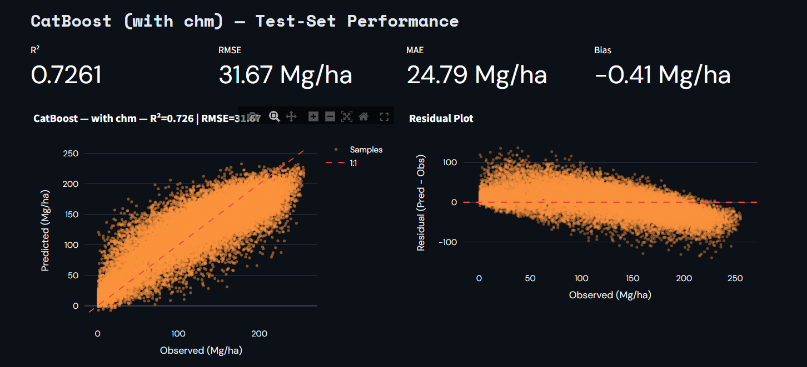
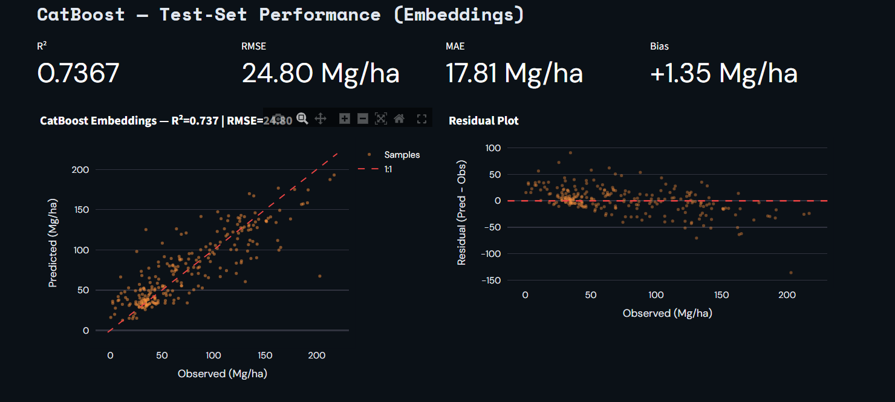
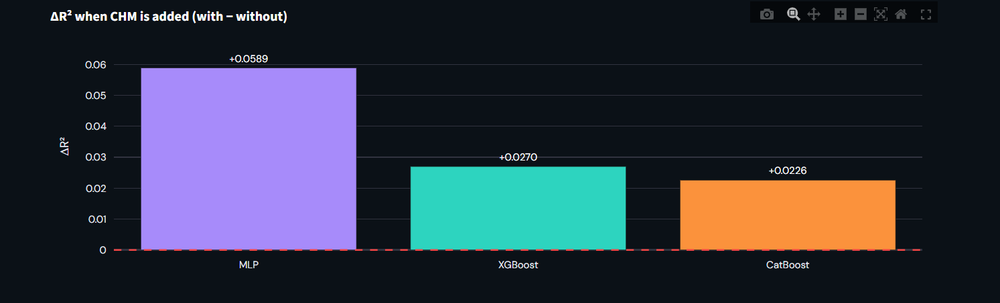
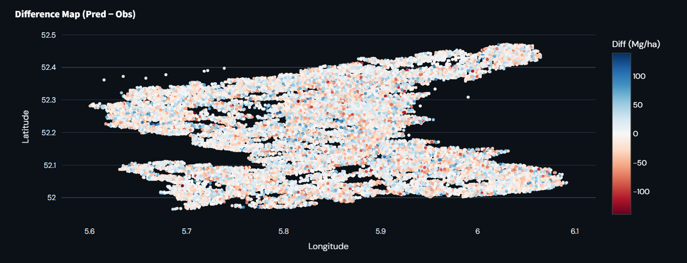
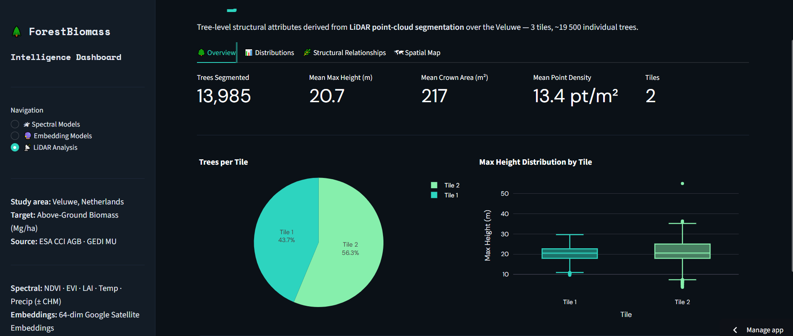
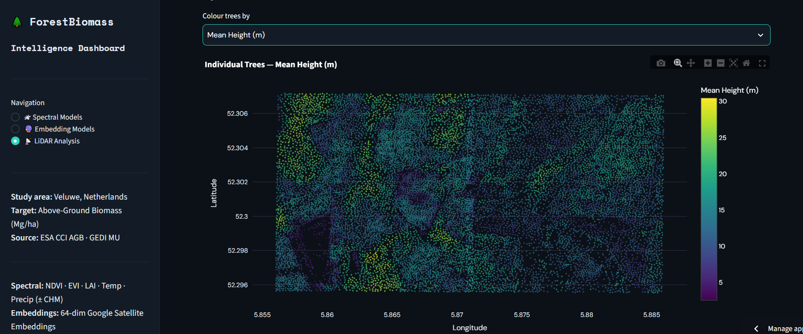

# 🌲 ForestBiomass Intelligence Dashboard

An interactive Streamlit dashboard for exploring **above-ground biomass (AGB) and carbon estimation** over the **Veluwe, Netherlands**, combining satellite spectral data, satellite embeddings, and LiDAR-derived tree structure with machine-learning models.

- **Study area:** Veluwe, Netherlands
- **Target variable:** Above-Ground Biomass (Mg/ha)
- **Reference data:** ESA CCI AGB · GEDI MU

---

## ✨ Features

The dashboard has three analysis pages, selectable from the sidebar.

### 1. 🛰️ Spectral Models
Regression models trained on spectral and climate predictors:
- **Predictors:** NDVI, EVI, LAI, Temperature, Precipitation (optionally **± CHM**, the canopy height model)
- **Models:** MLP, XGBoost, CatBoost
- **Variants:** `with_chm` / `without_chm`, to measure the value of canopy height
- **Outputs:** test-set metrics (R², RMSE, MAE, Bias), observed-vs-predicted plot, residual plot, residual distribution, observed / predicted / difference maps, and a raw predictions table

**Example result: CatBoost (with CHM)**

| R² | RMSE | MAE | Bias |
|----|------|-----|------|
| 0.7261 | 31.67 Mg/ha | 24.79 Mg/ha | -0.41 Mg/ha |

**Gain in R² when CHM is added (with − without)**

| Model | ΔR² |
|-------|-----|
| MLP | +0.0589 |
| XGBoost | +0.0270 |
| CatBoost | +0.0226 |

Adding canopy height improves every model, with the largest gain for the MLP.

### 2. 🔮 Embedding Models
Models trained on **64-dimensional Google Satellite Embeddings**, validated against GEDI MU footprints:
- MLP, XGBoost and CatBoost compared side by side
- Combined observed-vs-predicted plot for all embedding models
- Spatial maps of observed GEDI MU, predictions, and prediction error

**Example result: MLP (embeddings)**

| R² | RMSE | MAE | Bias |
|----|------|-----|------|
| 0.7025 | 26.37 Mg/ha | 19.51 Mg/ha | +0.86 Mg/ha |

### 3. 📡 LiDAR Analysis
Tree-level structural attributes derived from **LiDAR point-cloud segmentation** over the Veluwe:
- **Overview:** trees segmented, mean max height, mean crown area, point density, trees per tile
- **Distributions:** height and crown metric distributions by tile
- **Structural Relationships:** *Scatter Explorer* with selectable X/Y axes, marginal histograms and box plots
- **Spatial Map:** individual trees coloured by an attribute (tile, max/mean height, height std dev, height percentiles P25/P50/P75, crown radius, crown area, …)

---

## 🖼️ Screenshots

> Place your screenshots in a `docs/` folder and update the file names below.

| Spectral Models | Embedding Models |
|---|---|
|  |  |

| CHM impact | Difference map |
|---|---|
|  |  |

| LiDAR overview | Tree spatial map |
|---|---|
|  |  |

---

## 🚀 Getting Started

```bash
# 1. Clone the repository
git clone https://github.com/Zeineb19/ABGbiomass_Carbon_Dashboard.git
cd ABGbiomass_Carbon_Dashboard

# 2. (Optional) create a virtual environment
python -m venv .venv
source .venv/bin/activate        # Windows: .venv\Scripts\activate

# 3. Install dependencies
pip install -r requirements.txt

# 4. Launch the dashboard
streamlit run app.py
```

> Adjust `app.py` if your main script has a different name.

## 🧰 Tech Stack

- **Dashboard:** Streamlit, Plotly
- **Modelling:** scikit-learn, XGBoost, CatBoost, PyTorch/MLP,OpenCV
- **Data:** ESA CCI Biomass, GEDI, Google Satellite Embeddings, LiDAR point clouds
- **Language:** Python
- **Cloud preprocessing :**Cloud Compare ,Qgis/Arcgis,

## 📊 Method Summary

1. Build a reference AGB dataset from ESA CCI AGB and GEDI MU over the Veluwe.
2. Extract predictors: spectral indices and climate (NDVI, EVI, LAI, temperature, precipitation), canopy height (CHM), and 64-D satellite embeddings.
3. Train MLP, XGBoost and CatBoost regressors, with and without CHM.
4. Evaluate on a held-out test set with R², RMSE, MAE and Bias; inspect residuals and spatial error.
5. Segment individual trees from LiDAR and analyse their structural attributes.

## 📌 Key Takeaways

- Models reach R² of roughly **0.70–0.73** on held-out data.
- Canopy height (CHM) consistently improves performance across all models.
- Residuals show regression-to-the-mean behaviour: low biomass is slightly overestimated and high biomass underestimated.

## 👤 Author

**Zeineb** · [GitHub](https://github.com/Zeineb19)

## 📄 License

Add a license of your choice (e.g. MIT).
